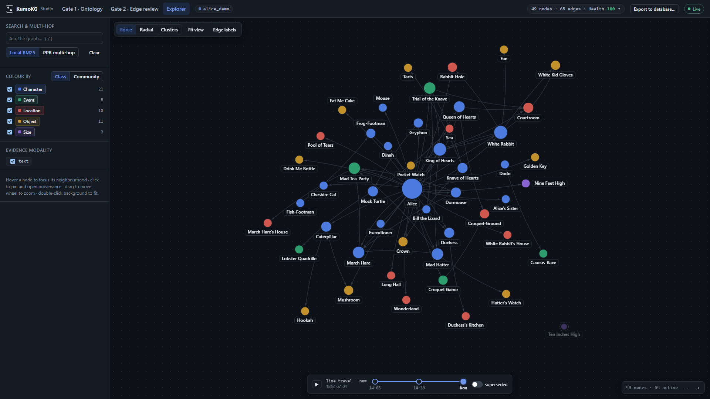
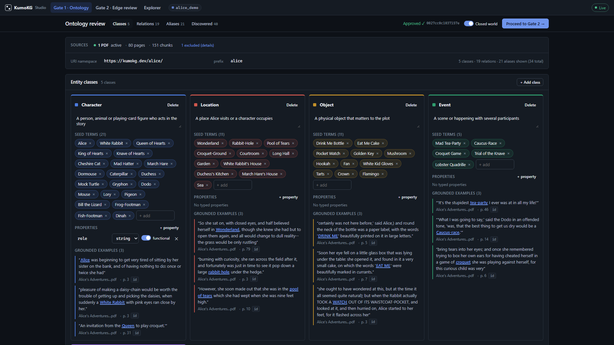
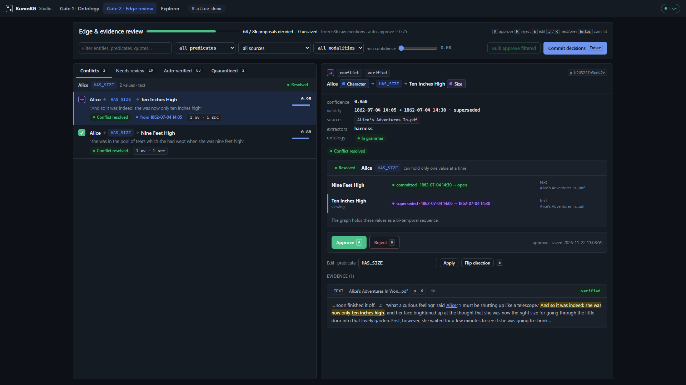
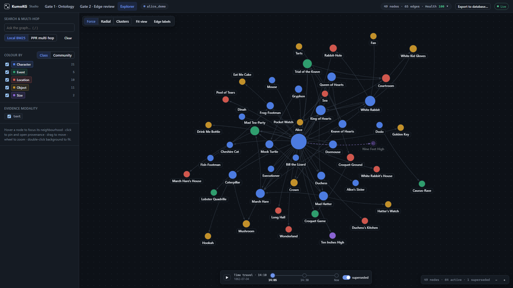
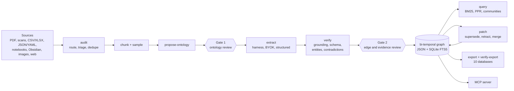

<div align="center">

# KumoKG

**Verified, quote-grounded knowledge graphs for coding agents.**

KumoKG turns any corpus into a provenance-grounded, bi-temporal knowledge graph, puts a human in the loop
where it matters, answers questions with cited GraphRAG, and exports to ten databases with automated parity checks.

[](LICENSE)
[](COMMERCIAL_LICENSE.md)
[](https://www.python.org/)
[](https://docs.astral.sh/uv/)
[](https://agentskills.io)
[](#development)
[](#export-to-10-databases)

[Install](#install) · [Quickstart](#quickstart) · [How it works](#how-it-works) · [Studio](#kumokg-studio) ·
[Exports](#export-to-10-databases) · [MCP](#mcp-server) · [License](#license)

<br/>



</div>

## Why KumoKG

LLM-built knowledge graphs usually fail quietly: invented edges, duplicate entities, and no way to tell
which claims are real. KumoKG is built so that **every edge has a receipt.**

- **Grounded by construction.** Every node and edge carries typed evidence: a verbatim quote with page number,
  a table cell, an RFC 6901 JSON pointer, a notebook cell, an image region or a web quote. Each one is
  re-verified in code. A claim that cannot be grounded never enters the graph.
- **Humans approve what matters.** Gate 1 reviews the ontology and Gate 2 reviews edges and evidence in a local
  Studio. Autonomous mode is one flag away.
- **Time-aware.** Corrections are bi-temporal: superseded facts keep `valid_from` / `valid_to`, so you can query
  the graph *as of* any moment and audit every change.
- **Agent-native.** It ships as a self-contained [Agent Skill](https://agentskills.io) for Codex, Claude Code,
  Cursor and OpenCode. Every CLI step prints compact JSON, so the agent never reads your raw files into context.
- **Zero-config extraction.** Your coding agent does the extraction itself (no API key), or bring your own
  OpenAI-compatible endpoint. A deterministic offline extractor covers CI.
- **Ships to production databases.** It exports to Neo4j, PostgreSQL (AGE / pgvector), Memgraph, FalkorDB, Amazon
  Neptune, ArangoDB, TigerGraph, JanusGraph, RDF stores and DuckDB, then re-parses every export to prove 100% parity.

## KumoKG Studio

A local, zero-build web app (vanilla ES modules and Canvas 2D) that binds to `127.0.0.1` only and works fully
offline.

<table>
  <tr>
    <td width="50%"></td>
    <td width="50%"></td>
  </tr>
  <tr>
    <td><b>Gate 1: ontology review.</b> Classes with removable seed terms, grounded examples with page
      citations, read-first relation and alias tables, and closed-world mode.</td>
    <td><b>Gate 2: edge &amp; evidence review.</b> Conflicts, needs review, auto-verified and quarantined
      tabs, highlighted evidence, a functional-conflict resolver and <code>A R E J K Enter</code> keys.</td>
  </tr>
  <tr>
    <td width="50%"></td>
    <td width="50%"></td>
  </tr>
  <tr>
    <td><b>Explorer.</b> Force, radial and cluster layouts, collision-free labels, ego-graph focus, PPR path
      highlighting, a provenance drawer and a health scorecard.</td>
    <td><b>Time travel.</b> Scrub the bi-temporal timeline: at 14:10 Alice is still ten inches high and the later
      nine-feet edge appears dashed as superseded history.</td>
  </tr>
</table>

The Explorer stays live: run `kumokg patch` in any terminal and an open Explorer refreshes in well under a second
(green `● Live` badge).

## Install

**Requirements:** Python 3.11+ and [uv](https://docs.astral.sh/uv/). The installer below also needs Node.js 22.20+.

### One command (recommended)

Install with the open [`skills`](https://github.com/vercel-labs/skills) CLI:

```bash
# Interactive: choose your agents
npx skills@latest add HimanshuMohanty-Git24/kumokg --skill kumokg

# OpenAI Codex (user-level)
npx skills@latest add HimanshuMohanty-Git24/kumokg --skill kumokg --agent codex --global

# Claude Code (user-level)
npx skills@latest add HimanshuMohanty-Git24/kumokg --skill kumokg --agent claude-code --global

# Cursor and OpenCode
npx skills@latest add HimanshuMohanty-Git24/kumokg --skill kumokg --agent cursor --global
npx skills@latest add HimanshuMohanty-Git24/kumokg --skill kumokg --agent opencode --global
```

Drop `--global` to install into the current project only. Add `--copy` to copy files instead of symlinking,
which is useful on Windows without developer mode.

### Manual install

The skill is the self-contained folder [`skills/kumokg/`](skills/kumokg). Copy it so that `SKILL.md` sits directly
inside a `kumokg/` folder in your agent's skills directory:

| Agent | Skills directory |
| --- | --- |
| OpenAI Codex | `~/.agents/skills/kumokg/` (older Codex builds: `~/.codex/skills/kumokg/`) |
| Claude Code | `~/.claude/skills/kumokg/` (or `.claude/skills/kumokg/` in a project) |
| Cursor | `.cursor/skills/kumokg/` in a project (or `~/.cursor/skills/kumokg/`) |
| OpenCode | `~/.config/opencode/skills/kumokg/` (or `.agents/skills/kumokg/` in a project) |

```bash
git clone https://github.com/HimanshuMohanty-Git24/kumokg.git
mkdir -p ~/.agents/skills && cp -R kumokg/skills/kumokg ~/.agents/skills/kumokg   # Codex example
uv run --directory ~/.agents/skills/kumokg kumokg --help                        # smoke check
```

```powershell
# Windows PowerShell
git clone https://github.com/HimanshuMohanty-Git24/kumokg.git
New-Item -ItemType Directory -Force "$HOME\.agents\skills" | Out-Null
Copy-Item -Recurse kumokg\skills\kumokg "$HOME\.agents\skills\kumokg"
uv run --directory "$HOME\.agents\skills\kumokg" kumokg --help
```

No uv? Run `python -m venv .venv && .venv/bin/pip install -e skills/kumokg` and use `.venv/bin/kumokg`.

## Quickstart

### In your coding agent

Once installed, just ask:

> *Build a knowledge graph from `./docs` and open the Studio so I can review it.*
>
> *How is the Knave of Hearts connected to the King? Cite the pages.*
>
> *Correction: from 14:30 Alice is nine feet tall. Update the graph and keep the history.*
>
> *Export the graph to Neo4j and verify the export.*

`SKILL.md` routes the agent through a resumable state machine. It checks `status` first, asks one question at
most (HITL or Autonomous, and only for large corpora Harness or BYOK), and loads each phase guide in
`references/` only when that phase starts.

### From the CLI

```bash
KG="uv run --project skills/kumokg kumokg"

$KG audit ./docs --workspace ./my-kg                     # route modalities, triage scanned PDFs, dedupe
$KG chunk --workspace ./my-kg
$KG sample --workspace ./my-kg --n 12                    # stratified preview for ontology design
$KG propose-ontology --workspace ./my-kg --from draft.json
$KG studio --workspace ./my-kg --gate gate1 --blocking   # Gate 1 in the browser
$KG compile-structured --workspace ./my-kg               # zero-token tables / JSON / notebooks / vaults
$KG export-batches --workspace ./my-kg                   # Tier 1: your agent extracts (no API key)
$KG import-candidates ./my-kg/.kumokg/batches/batch-0001.out.jsonl --workspace ./my-kg
$KG verify --workspace ./my-kg                           # grounding, ontology, entities, contradictions
$KG studio --workspace ./my-kg --gate gate2 --blocking   # Gate 2 in the browser, then Commit
$KG doctor --workspace ./my-kg                           # graph health scorecard
$KG query "How is Alice connected to the Queen?" --mode ppr --workspace ./my-kg
$KG export --target all --workspace ./my-kg && $KG verify-export --target all --workspace ./my-kg
```

<details>
<summary><b>All CLI commands</b></summary>

| Command | What it does |
| --- | --- |
| `init`, `status` | Create or resume a workspace; instant summary of phase, gates and counts |
| `audit` | Scan sources, route modalities, triage PDFs for OCR/VLM, dedupe, record exclusions with reasons |
| `chunk`, `sample` | Deterministic chunking; stratified sample for ontology discovery |
| `propose-ontology`, `ontology-edit`, `approve-ontology` | Draft, edit and approve the ontology (Gate 1) |
| `compile-structured` | Zero-token compilation of tables, JSON/YAML, notebooks and Obsidian vaults |
| `media-prep` | Render scanned pages and collect images and charts for vision extraction |
| `export-batches`, `import-candidates` | Tier 1 harness extraction (resumable, duplicate-safe) |
| `extract` | Tier 2 BYOK pool or the offline heuristic baseline |
| `verify` | Programmatic grounding, ontology checks, entity resolution, contradiction detection |
| `decide`, `commit` | Gate 2 decisions from the CLI and append-only commit |
| `doctor` | Health scorecard: grounding %, schema compliance %, contradictions, orphans, coverage |
| `query` | GraphRAG: `local` (BM25 neighbourhood), `ppr` (ontology-constrained multi-hop), `lazy-global` (communities) |
| `patch`, `history` | Verified, atomic, bi-temporal edits plus the changelog |
| `studio` | Gate 1, Gate 2 and the live Explorer on `127.0.0.1` |
| `serve-mcp` | Expose the graph as MCP tools |
| `adapters`, `export`, `verify-export` | List targets, export offline bundles or push live, re-verify parity |
| `eval` | Golden 2-hop/3-hop benchmark: Entity/Edge Recall@K, citation grounding, latency |

</details>

## How it works



All state lives in `<workspace>/.kumokg/` (manifest, chunks, candidates, decisions, graph, changelog), so any
step can be resumed and nothing is hidden in the agent's context.

### Inputs and evidence

| Input | Evidence that grounds a claim | Verification |
| --- | --- | --- |
| PDF, DOCX, PPTX, Markdown, text, Obsidian notes | verbatim quote + page | exact match after whitespace/case folding; fuzzy matches are flagged for review |
| CSV / XLSX | table cell (sheet, row, column) | cell value re-read from the file |
| JSON / YAML | RFC 6901 JSON pointer | pointer resolved against the document |
| Jupyter notebooks | cell index + source | cell content re-read |
| Images, scanned pages, charts | image region | routed to visual confirmation at Gate 2 |
| Web pages | quote + URL | quote located in the fetched page |

Scanned PDFs are detected page by page and offered four remediation paths. Corrupt, empty and duplicate files are
excluded with a recorded reason.

### Extraction tiers

- **Tier 1: Harness (zero config).** `export-batches` writes small task files (5-8 chunks or 2-4 images, with the
  ontology and calibration rules attached). Your agent answers them and `import-candidates` ingests the JSONL.
- **Tier 2: BYOK.** Copy [`env.example`](skills/kumokg/assets/templates/env.example) to `<ws>/.kumokg/.env`, then run
  `kumokg extract --extractor byok --kind all`. This gives you a bounded async pool, schema-validated JSON, retries
  and resume.

  ```ini
  KUMOKG_LLM_PRESET=groq      # groq | openrouter | openai | ollama, or any OpenAI-compatible base URL
  KUMOKG_LLM_API_KEY=...      # not needed for local Ollama
  KUMOKG_VLM_MODEL=...        # optional vision model for scanned pages and images
  ```

- **Offline baseline.** `--extractor heuristic` is a deterministic cue-phrase extractor, used in CI.

### HITL vs Autonomous

| | HITL (default) | Autonomous |
| --- | --- | --- |
| Gate 1 ontology | Browser review at `/gate1`, then **Approve & Continue** | `approve-ontology` |
| Gate 2 edges | `/gate2` tabs: conflicts, needs review, auto-verified (bulk approve), quarantined | `decide --auto` approves only auto-verified, high-confidence proposals |
| Corrections | `patch` (verified, bi-temporal, logged) | same |

Every Gate 2 decision feeds a calibration file, so future batches learn from your approvals and rejections.

### Query, correct and time-travel

```bash
$KG query "Who did Alice meet at the Mad Tea-Party?" --mode local --workspace ./my-kg
$KG query "How is Alice connected to the stolen tarts?" --mode ppr --hops 3 --workspace ./my-kg
$KG query "What happens at the trial?" --mode lazy-global --workspace ./my-kg

# A verified correction that keeps history: the old edge gets valid_to, the new one valid_from
$KG patch supersede-edge --edge-id <id> --target "Nine Feet High" --target-label Size --create \
  --valid-from 1862-07-04T14:30 --quote "in fact she was now more than nine feet high" --workspace ./my-kg

$KG query "How tall is Alice?" --as-of 1862-07-04T14:10 --workspace ./my-kg   # answers from before the change
$KG history --workspace ./my-kg
```

Answers come back as a compact context with `[source p.N]` citations for the agent to quote.

## Export to 10 databases

| Target | Offline bundle | Live push extra |
| --- | --- | --- |
| Neo4j | `neo4j-admin` typed CSVs, `schema.cypher`, `import.cypher` | `--extra neo4j` |
| PostgreSQL (plain / Apache AGE / pgvector) | `schema.sql`, `data/*.csv`, `load.sql`, `age_load.sql` | `--extra postgres` |
| Memgraph | CSVs, `schema.cypherl`, `load.cypherl` | `--extra memgraph` |
| FalkorDB | bulk-loader CSVs, `schema.cypher`, `load_bulk.sh` | `--extra falkordb` |
| Amazon Neptune (LPG / RDF) | bulk-load CSVs or N-Quads + `loader-request.json` | `--extra neptune` |
| ArangoDB | vertex/edge JSONL, `graph_definition.json`, `import.sh` | `--extra arangodb` |
| TigerGraph | `schema.gsql`, `loading_job.gsql`, typed CSVs | `--extra tigergraph` |
| JanusGraph | `schema.groovy`, GraphSON 3.0, `load.groovy` | `--extra janusgraph` |
| RDF (GraphDB, Stardog, Oxigraph, Jena) | OWL 2, SHACL, Turtle, N-Quads, JSON-LD | `--extra rdf` |
| DuckDB | Parquet, DuckPGQ SQL, GraphML, `kumokg.duckdb` | built in |

Provenance can travel as properties, evidence nodes or reified statements (`--provenance-mode props|nodes|reified`).
`verify-export` re-parses every file and asserts 100% node/edge parity, zero dangling endpoints and valid syntax.
For live push, add `--push` with credentials in `<ws>/.kumokg/.env`.

## MCP server

```bash
uv run --project skills/kumokg --extra mcp kumokg serve-mcp --workspace ./my-kg
```

Tools: `kg_query`, `kg_ppr_multihop`, `kg_get_evidence`, `kg_time_travel`, `kg_patch`, `kg_doctor`, `kg_export`.

## Benchmark: Alice's Adventures in Wonderland

The end-to-end test builds a graph from an 80-page PDF of *Alice's Adventures in Wonderland* (in `Data/`):

| Stage | Result |
| --- | --- |
| Audit | 1 PDF active (80 pages, 151 chunks); the Markdown copy excluded as a 99.8% duplicate |
| Extraction | 686 raw mentions grouped into 86 proposals: 63 auto-verified, 19 for review, 2 conflicts, 2 quarantined hallucinations |
| Graph | 49 nodes, 65 edges (64 active + 1 superseded by a bi-temporal patch), 8 communities |
| Health | 100% grounding, 100% schema compliance, 100% source integrity, score 100/100 |
| Eval (15 multi-hop questions) | local Entity Recall@10 0.76, Edge Recall@20 0.92; PPR Answer Hit@10 0.53; 100% citation grounding |
| Exports | 10/10 targets pass `verify-export` |

## Security and privacy

- The Studio binds to `127.0.0.1`, rejects foreign `Host` / `Origin` headers (DNS-rebinding protection) and serves
  a strict Content Security Policy with no third-party assets.
- Your sources stay on disk. The agent works from compact CLI summaries, never raw files.
- Secrets live only in `<workspace>/.kumokg/.env`. Network calls happen only for BYOK extraction, web sources you
  list, and live database pushes you request.

## Project structure

```text
kumokg/
├── skills/kumokg/              # the self-contained Agent Skill (what gets installed)
│   ├── SKILL.md                # ~100-line agent playbook: state machine + hard rules
│   ├── references/             # 5 phase guides, loaded only when a phase starts
│   ├── scripts/
│   │   ├── kumokg_cli.py       # CLI; every command prints compact JSON
│   │   ├── core/               # IR, modality router, verifier, patcher, retrieval, eval, MCP
│   │   ├── adapters/           # 10 database exporters + registry.json
│   │   └── studio/             # local Studio server (SSE live updates)
│   ├── assets/studio/          # zero-build UI: vanilla ES modules + Canvas 2D
│   ├── assets/templates/       # env.example for BYOK and live push
│   ├── pyproject.toml
│   ├── LICENSE
│   └── COMMERCIAL_LICENSE.md
├── tests/                      # pytest suites + synthetic multi-modal fixture generator
├── Data/                       # real-world corpus for the end-to-end test
├── docs/assets/                # README screenshots
├── docker-compose.test.yml     # optional live database stack
├── BUILD_PROGRESS.md           # engineering decision log
├── LICENSE
└── COMMERCIAL_LICENSE.md
```

## Development

```bash
uv run pytest                                     # unit, synthetic multi-modal and end-to-end suites
docker compose -f docker-compose.test.yml up -d   # optional live database stack
KUMOKG_LIVE_TESTS=1 uv run --project skills/kumokg --extra all-db pytest -m live
```

`tests/generate_fixtures.py` builds a synthetic torture corpus: a scanned PDF without OCR, a corrupt PDF,
CSV/XLSX with foreign keys, nested JSON/YAML, a notebook with an embedded chart, an Obsidian vault, duplicate
images, a hallucinated claim, a cross-source contradiction and a bi-temporal update. The suite also enforces the
skill budget (`SKILL.md` ≤ 220 lines / 6 KB), runs the skill from an isolated copy, and checks that every script
parses on Python 3.11. [`BUILD_PROGRESS.md`](BUILD_PROGRESS.md) records every engineering decision.

## Contributing

Issues and pull requests are welcome. KumoKG is dual-licensed, so contributions can only be merged under terms that
let them be offered under both licenses. Please open an issue before starting a larger change.

## License

KumoKG is **source-available and dual-licensed**:

| Use | License | Cost |
| --- | --- | --- |
| Personal projects, hobby use, academic and public research, non-commercial organizations | [PolyForm Noncommercial License 1.0.0](LICENSE) | **Free** |
| Any commercial use: internal company or enterprise workflows, commercial products and SaaS, paid consulting or agency deliverables, commercial distribution | [KumoKG Commercial License](COMMERCIAL_LICENSE.md) | **Paid** |

If you are using KumoKG at or for a for-profit company, you need a commercial license. See
[`COMMERCIAL_LICENSE.md`](COMMERCIAL_LICENSE.md) for tiers, or email
[codehimanshu24@gmail.com](mailto:codehimanshu24@gmail.com?subject=KumoKG%20Commercial%20License) to get a quote.

Copyright 2026 Himanshu Mohanty.

## Acknowledgements

*Alice's Adventures in Wonderland* by Lewis Carroll is in the public domain. Licensing terms are from the
[PolyForm Project](https://polyformproject.org).
